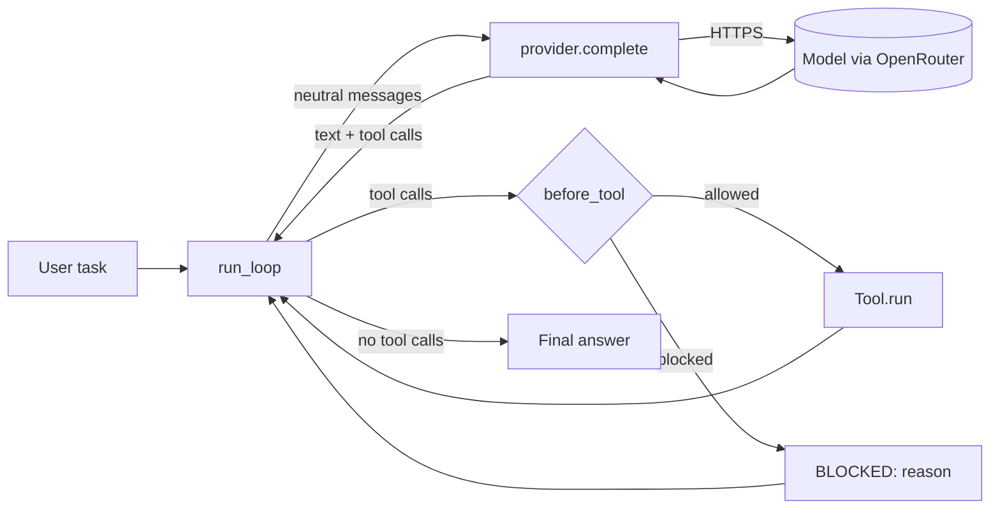

# Yogam

A minimal, readable agent harness in Python. **Standard library only. No third-party packages.**

Yogam is a teaching-grade reference implementation: a small, well-documented codebase that shows
how an LLM agent actually works - the loop, the tools, the provider boundary - with nothing hidden
behind a framework. It is built one day at a time, and each file opens with a docstring naming the
day, the concept it teaches and the design rules it follows.

[](https://www.python.org/)
[](#design-principles)

## Status

| Day | Topic | State |
|-----|-------|-------|
| 1 | Provider and agent loop | Done - covered by offline tests |
| 2+ | Tools, security, context, memory, skills, sessions, sub-agents, CLI | Planned |

Day 1 is verified offline against a fake local server. A live run against OpenRouter is the
remaining check (see [Try it live](#try-it-live)).

## How it works

An agent is a model called in a loop: ask, run the tools the model requests, feed the results
back, repeat until it answers in plain text.



The provider is the only file that knows the wire format. Everything above it speaks a small
neutral message format, so switching model or vendor touches one file.

## Quick start

Requirements: Python 3.10+ and an [OpenRouter](https://openrouter.ai) API key.

```bash
git clone https://github.com/vikas434/yogam-ai.git
cd yogam-ai

cp .env.example .env          # then edit .env and add your key
python3 -m unittest discover -s tests -v   # offline, no key or network needed
```

### Configuration

The key is read from the `OPENROUTER_API_KEY` environment variable, or from a git-ignored `.env`
file at the repository root. A real environment variable always wins over `.env`.

| Variable | Purpose |
|----------|---------|
| `OPENROUTER_API_KEY` | OpenRouter credential (required for live calls) |

The default model is `google/gemini-3.1-pro-preview`; pass any OpenRouter model id to override it.

### Try it live

```bash
python3 demos/day1_dice.py                       # default model
python3 demos/day1_dice.py anthropic/claude-sonnet-5-5   # any OpenRouter model id
```

You should see the assistant request the `roll_dice` tool, the tool result, and a final answer.

## Using the loop

```python
from yogam import loop, provider

class Greeter:
    spec = {"schema": {"name": "greet", "description": "Greet someone",
                       "parameters": {"type": "object", "required": ["name"],
                                      "properties": {"name": {"type": "string"}}}}}
    def run(self, name):
        return f"Hello, {name}!"

history = [{"role": "user", "text": "Greet Ada"}]
answer = loop.run_loop(
    model=provider.DEFAULT_MODEL,
    system="You are a helpful assistant.",
    messages=history,
    tools={"greet": Greeter()},
    on_event=lambda kind, payload: None,   # "assistant", "tool_start", "tool_end"
    before_tool=lambda call: None,          # return a string to block the call
)
```

A **tool** is any object with a `.spec` (the JSON schema the model sees) and a `.run(**kwargs)`
callable. `before_tool(call)` returns `None` to allow a call or a reason string to block it.

### Neutral message format

```text
{"role": "user", "text"}
{"role": "assistant", "text", "tool_calls": [{"id", "name", "args"}], "reasoning"}
{"role": "tool", "id", "name", "text"}
```

## Repository layout

```text
yogam/
  provider.py    Wire format, auth, retries; the only file that talks to the network
  loop.py        The agent loop, tool execution, turn budget
demos/
  day1_dice.py   One hand-written tool driven by the loop
tests/
  test_offline.py  Provider and loop tested against a fake OpenRouter server
day1_prompt.md   The build prompt for day 1
```

## Design principles

- **Standard library only.** `urllib`, `json`, `os`, `time` - nothing to install.
- **The loop never crashes because a tool did.** Failures become tool results:
  `ERROR: <ExceptionType>: <message>`, `ERROR: unknown tool <name>`, `BLOCKED: <reason>`.
- **Policy lives outside the loop.** `before_tool` can veto any call; `before_turn` can rewrite
  history (reserved for context compaction on day 3).
- **Guaranteed termination.** After `max_turns` (default 80) the loop makes one final tool-free
  call asking the model to wrap up.
- **Resilient transport.** HTTP 429/500/502/503 and network errors retry with exponential backoff;
  other HTTP errors raise `RuntimeError` with a bounded excerpt of the response body.
- **Reasoning round-trips.** Some models (for example Gemini 3) reject follow-up turns unless their
  reasoning is echoed back verbatim, so the provider preserves and resends it untouched.

## Security

- The API key travels only in the `Authorization` header - never in a URL, log line or error message.
- `.env` is git-ignored; only `.env.example` with a placeholder is committed.
- Tests use a fake key and a local server, so they never touch the network or a real credential.

## Testing

```bash
python3 -m unittest discover -s tests -v
```

The suite covers the tool round trip and wire format, reasoning echo, plain prompts with no tools,
blocked / unknown / failing tools, the turn limit, retry and error handling, and the missing-key
message.

## Roadmap

Tools and edit safety, a security layer, context management, memory, skills, sessions, sub-agents,
a unified harness, a CLI (`python3 -m yogam`) and a multi-agent fleet runner.

## License

No license has been chosen yet. Until one is added, all rights are reserved by the author.
